# Agent Run Monitor

[](https://github.com/PastFumbler/agent-run-monitor/actions/workflows/ci.yml)
[](https://github.com/PastFumbler/agent-run-monitor/releases/latest)
[](LICENSE)


**See what all your coding agents are doing, in one calm window. Read-only, local-only, no account.**

Agent Run Monitor is a desktop app for Windows, macOS and Linux that shows what your coding agents are doing. Claude Code, Codex, Gemini CLI, GitHub Copilot, Aider, Cursor and others save each session to a file on your computer. The app reads those files and shows every session as a **run**: what it is doing now, what it did, which files it changed, and whether it finished, failed, is waiting for you or looks stuck. It only reads. It never controls an agent, and it never changes an agent's files.

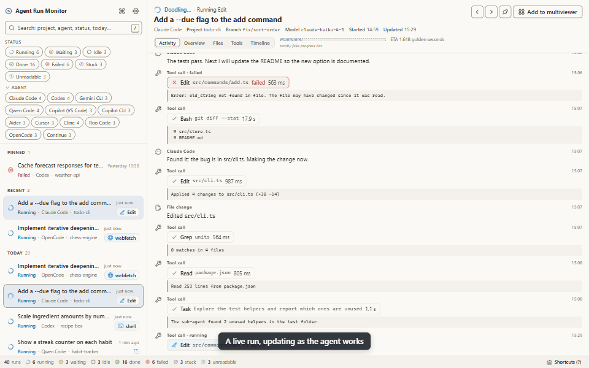

All pictures on this page come from the app's built-in demo, which uses made-up runs.

## Highlights

- **12 agents, one view.** Claude Code, Codex, Gemini CLI, Qwen Code, Copilot in VS Code, Copilot CLI, Aider, Cursor, Cline, Roo Code, Continue and OpenCode, all shown in the same format.
- **Live.** Runs update within a second or two of the agent writing. You see the current tool call, the latest messages and reasoning, and the files being changed.
- **Clear status.** Running, waiting for you, idle, done, failed, stuck, or couldn't be read. Each status has its own shape and word as well as a colour.
- **Multiviewer.** Watch up to 12 runs side by side, each tile with its own view. Layouts can be saved.
- **Fast to get around.** Arrow keys between runs, `Ctrl+K` command palette, filter chips, pinned and recent runs, and a shortcut sheet on `?`.
- **Private by design.** Read-only, no network calls unless you opt in, no telemetry, and secrets masked on screen by default.
- **Easy on your machine.** Low GPU mode (automatic on battery), reduce motion, and everything pauses while the window is hidden.
- **Set up in a minute.** A first-run wizard finds your installed agents on its own and shows how many runs each has.

## Quick start

1. Download the installer for your system from the [releases page](https://github.com/PastFumbler/agent-run-monitor/releases/latest) (Windows `setup-x64.exe`, macOS `.dmg`, Linux `.AppImage` or `.deb`). Details: [Install](#install).
2. Start **Agent Run Monitor**. The setup wizard finds your agents and shows what it found.
3. Click **Open my latest run**. Start a session in any supported agent and it appears in the list within seconds.

## Privacy

- **Read-only.** The app opens agent files for reading only. It never writes, renames, moves or deletes anything in any agent's folders. Two agents (Cursor and OpenCode) keep their sessions in a database. For those, the app copies the database into its own temporary folder and reads the copy, so the original is never opened by a database engine. A test in the code fails the build if any other parsing code uses a file-writing function.
- **Local-only.** Everything stays on your computer. There is no account, no telemetry, no analytics and no crash reporting. The app makes no network calls. It blocks every web request that is not for its own files, and the spellchecker (which would download dictionaries) is switched off.
- **Two optional exceptions, both off by default.**
  - **The update check.** If you turn it on (Settings > Privacy > Check for updates), the app sends one request to GitHub Releases to see whether a newer version exists. Nothing about you or your runs is sent.
  - **AI summaries.** Each run's Overview starts with a summary built on your computer. If you turn on AI summaries (Settings > AI summary) and save your own Anthropic or OpenAI API key, the app first warns you that run content will be sent to that provider. After that, opening a run's Overview sends that one run's request, changed file names and recent messages and tool calls (at most about 8,000 characters) to the provider, from the main process only. Likely secrets are masked before sending, even when on-screen masking is off. Your key stays in the main process, encrypted by your operating system's secure storage (or kept only until you quit where there is none); it is never shown again or logged. Summaries are saved in the app's own folder, so the same run content is never sent twice. If a request fails, Overview shows the local summary with a short note.
- **Secrets are masked on screen.** "Mask likely secrets" is **on** by default. Before any text reaches the window, the app replaces things that look like secrets with `••••` and a label, for example `sk-…••••[OpenAI key]`. It covers API keys and tokens from OpenAI, Anthropic, Google, GitHub, GitLab, Slack, Stripe, AWS, npm, Hugging Face, SendGrid, Twilio, xAI, Groq and others; bearer and basic auth headers; JWTs; private key blocks; `password=` and `secret=` style settings; and connection strings or URLs with a password in them. Masking only changes what you see; your files stay as they are. It works by recognising patterns, so it can miss an unusual secret. Take care when you share screenshots.
- **Sandboxed window.** The window runs in Chromium's sandbox with context isolation and no Node.js access. It cannot load anything from the internet, and it only gets runs in the app's own common format, never raw agent files.

More detail: [SECURITY.md](SECURITY.md) and section 3.4 of [the plan](docs/PLAN.md#34-privacy-and-security-model).

## Contents

- [Supported agents](#supported-agents)
- [What can't be monitored](#what-cant-be-monitored)
- [How it works](#how-it-works)
- [Install](#install)
- [First launch](#first-launch)
- [Connecting each agent](#connecting-each-agent)
- [Where each agent stores its sessions](#where-each-agent-stores-its-sessions)
- [Using the app](#using-the-app)
- [Troubleshooting](#troubleshooting)
- [Uninstall](#uninstall)
- [FAQ](#faq)
- [Code overview](#code-overview)
- [Development](#development)
- [Project status](#project-status)
- [Contributing](#contributing)
- [Licence](#licence)

## Supported agents

"Verified" means checked against a real installation. "Checked against source" means checked against the agent's published source code, but not against a real installation yet. "Experimental" means neither was possible (the agent is closed source and was not installed); expect gaps.

| Agent | Status | What it reads |
| --- | --- | --- |
| Claude Code (CLI, IDE extensions, desktop app) | Verified on a real install (Windows; macOS and Linux paths come from Claude Code's own code) | Session transcripts, sub-agents and workflow runs in `~/.claude/projects`, plus `~/.claude/sessions` for "waiting for approval" |
| Codex (CLI, `codex exec`, IDE extension, desktop app, ChatGPT's Codex) | Checked against source | Rollout files in `~/.codex/sessions` and `~/.codex/archived_sessions` |
| Gemini CLI | Checked against source | `~/.gemini/tmp/<project>/chats` |
| Qwen Code | Checked against source | `~/.qwen/projects/<project>/chats` |
| GitHub Copilot in VS Code (ask, edit and agent mode) | Checked against source (folder locations seen on a real Windows install) | VS Code's saved chat sessions (`workspaceStorage/*/chatSessions` and chats from windows with no folder) |
| GitHub Copilot CLI | Checked against source | `~/.copilot/session-state/<id>/events.jsonl` |
| Aider | Checked against source | `.aider.chat.history.md` in the project folders you choose, and in your home folder |
| Cursor | Experimental | Cursor's chat database (a temporary copy), cursor-agent CLI sessions and agent transcripts |
| Cline | Checked against source | Tasks in your editor's extension storage (VS Code, Insiders, VSCodium, Cursor, Windsurf) and Cline 4.x sessions in `~/.cline/data`. Never reads `secrets.json` |
| Roo Code | Checked against source | Tasks in your editor's extension storage |
| Continue | Checked against source | `~/.continue/sessions` |
| OpenCode | Checked against source | `~/.local/share/opencode`: its database (a temporary copy) and older JSON files |

The exact folders for each operating system are in [Where each agent stores its sessions](#where-each-agent-stores-its-sessions). The same information is shown in the app under Settings > Sources. Goose and Crush are the next agents planned; see [CONTRIBUTING.md](CONTRIBUTING.md#adding-a-source-adapter) if you want to help.

## What can't be monitored

- **ChatGPT web and desktop apps.** Ordinary ChatGPT chats write no run data to your computer, so there is nothing to read. ChatGPT's coding agent is different: it is Codex, and Codex is supported (it writes its sessions to `~/.codex`).
- **Windsurf.** Its Cascade sessions are stored encrypted, so they can't be read. (Cline or Roo Code running *inside* Windsurf are supported.)
- **Cloud-only agents**, such as Codex cloud tasks, the Copilot coding agent on github.com, Devin and Jules. They run on someone else's computer and leave nothing on yours.
- **"Waiting for approval" is not always certain.** Only Claude Code and Copilot CLI record that they are waiting for you. For the other agents the app works it out from a tool call with no answer and a file that has gone quiet, so it can be wrong.
- **Exact times for every message.** Aider records only when a session started, and Continue keeps no per-message times. Their events are shown in order, without exact times.

## How it works

Coding agents keep a log of every session on your disk, usually one file per session that grows as the agent works. Agent Run Monitor watches those folders and reads the logs as they change.

```mermaid
flowchart LR
  subgraph disk["Your disk (read only)"]
    direction TB
    a1["~/.claude/projects/…/*.jsonl"]
    a2["~/.codex/sessions/…/rollout-*.jsonl"]
    a3["Cursor / OpenCode databases"]
    a4["…and the other agents"]
  end
  subgraph main["App, background part"]
    direction TB
    w["Watcher<br/>(file events + slow poll)"] --> ad["Adapters<br/>(one per agent)"]
    ad --> st["Run store<br/>(status, batching)"]
    st --> mk["Secret masking"]
  end
  subgraph ui["App window (sandboxed)"]
    direction TB
    v["Run list · run views<br/>multiviewer · settings"]
  end
  disk --> w
  mk -- "runs in one common format" --> v
```

1. **Find.** For each agent, a small *adapter* knows where that agent saves its sessions on Windows, macOS and Linux, including the environment variables that move them. The first-run wizard uses this to show what is installed.
2. **Read.** When a session file grows, the adapter reads only the new part (it remembers how far it got), so even a 200 MB session costs almost nothing to follow. Every agent's own format is turned into one common format: a run with a title, project, model and status, and a list of events (messages, reasoning, tool calls and results, file changes and errors).
3. **Judge.** The app works out each run's status from what the file says and how long it has been quiet. For example, a finished turn is *idle* for 3 minutes and then *done*; a run that looks busy but has been silent for 20 minutes is *stuck*; a shell command open for more than 12 minutes is *stuck*. Codex doesn't record when it is waiting for your approval, so a Codex tool call with no answer for a minute shows as **Probably waiting**.
4. **Mask.** Before anything reaches the window, text that looks like a secret is replaced with `••••`.
5. **Show.** Changes are sent to the window in small batches (4 a second normally, once a second in low GPU mode, every 5 seconds while the window is hidden), so following many busy runs stays cheap.

If a file can't be understood (for example after an agent changes its format), that one run shows **Couldn't read this run** with the reason, and everything else keeps working.

## Install

Download the latest version from the [releases page](https://github.com/PastFumbler/agent-run-monitor/releases).

### Windows

Two choices:

- **Installer** (`agent-run-monitor-<version>-setup-x64.exe` for most PCs, or `-setup-arm64.exe` for Arm PCs). Double-click it. It asks no questions: it installs for your user account only, never asks for administrator rights, and is done in a few seconds. It installs into `%LOCALAPPDATA%\Programs\agent-run-monitor`, adds an **Agent Run Monitor** shortcut to the Start menu and the desktop, and starts the app when done. To remove the app, see [Uninstall](#uninstall).
- **Portable zip** (`agent-run-monitor-<version>-win-x64.zip`, or `-win-arm64.zip`). Right-click > Extract All, then run `Agent Run Monitor.exe` from the extracted folder. Nothing is installed, but your settings are still saved in `%APPDATA%\Agent Run Monitor` (see [Uninstall](#uninstall)).

**Windows may warn you.** Builds are not code-signed until the project has a signing certificate set up (see [docs/BLOCK-TEST.md](docs/BLOCK-TEST.md)).

- *SmartScreen* may say "Windows protected your PC". Click **More info**, then **Run anyway**.
- *Smart App Control*, if it is switched on, blocks unsigned apps and has no "run anyway" button. In that case wait for a signed release.

### macOS

Download the `.dmg` (`arm64` for Apple silicon Macs, `x64` for Intel Macs), open it and drag **Agent Run Monitor** to Applications.

The app is not signed or notarised yet, so macOS stops it the first time:

- Control-click (or right-click) the app in Applications, choose **Open**, then **Open** again.
- If that doesn't offer an Open button (macOS 15 and later), try to open the app once, then go to **System Settings > Privacy & Security**, scroll down and click **Open Anyway**.

### Linux

- **AppImage**: make it executable, then run it.

  ```sh
  chmod +x agent-run-monitor-<version>-linux-<arch>.AppImage
  ./agent-run-monitor-<version>-linux-<arch>.AppImage
  ```

  Some distributions need the FUSE 2 library for AppImages (on Ubuntu, the `libfuse2` package).

- **Debian or Ubuntu package**:

  ```sh
  sudo apt install ./agent-run-monitor-<version>-linux-<arch>.deb
  ```

## First launch

The first time you start the app, a short setup wizard opens. It has four steps:

1. **Welcome**, with the privacy promise.
2. **Find your agents.** The app checks the usual folder of every supported agent and shows what it found: the folder and how many runs are in it, or where the agent's folder would be if it isn't installed. You can switch any agent off, or add a folder if an agent keeps its sessions somewhere else. For Aider you add your project folders here.
3. **Look & feel**: pick a theme, choose whether to reduce motion, and whether you want the fun extras.
4. **Done.** Click **Open my latest run** and the app opens on your most recent run. With a large history the list keeps filling for a few seconds ("Reading runs…" in the status bar). If no runs were found, the button says **Start watching** and the list stays empty until an agent writes a session; see [My runs don't appear](#my-runs-dont-appear).

Use **Next** to go through the steps, or **Skip setup** to jump to the end.

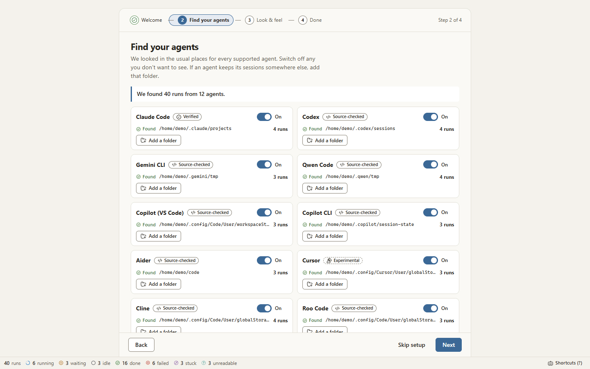

You can change all of this later in Settings (Ctrl+, or ⌘, on a Mac).

## Connecting each agent

For most agents there is nothing to do: if the agent is installed and has saved at least one session, the app finds it.

**A note on environment variables.** Some agents let you move their data with an environment variable (listed below). The app honours these, but only if it can see them. If you set one in your terminal profile only, the app may not see it when you start it from the Start menu, Dock or launcher. The simple fix is to add the folder by hand: Settings > Sources > the agent > **Add folder**.

### Claude Code

Nothing to do. Covers the CLI, the IDE extensions and the desktop app's Code tab. If you use `CLAUDE_CONFIG_DIR`, the app reads that folder too.

### Codex

Nothing to do. Covers the CLI, `codex exec`, the IDE extension, the desktop app and Codex inside ChatGPT. If you use `CODEX_HOME`, the app reads that folder instead of `~/.codex`.

### Gemini CLI

Nothing to do. If you use `GEMINI_CLI_HOME`, the app looks for `.gemini` inside that folder instead of your home folder.

### Qwen Code

Nothing to do. `QWEN_HOME` and `QWEN_RUNTIME_DIR` are honoured.

### GitHub Copilot in VS Code

Nothing to do. The app reads the chats that VS Code (and VS Code Insiders or VSCodium) saves. A portable VS Code is found through `VSCODE_PORTABLE`; otherwise add its `user-data/User` folder by hand. See also [VS Code Copilot chats](#vs-code-copilot-chats-dont-appear).

### GitHub Copilot CLI

Nothing to do. If you use `COPILOT_HOME`, the app reads that folder.

### Aider

Aider has no central folder. It writes `.aider.chat.history.md` into each project (in the git root, or the folder you started it in). So **tell the app where your projects are**: Settings > Sources > **Project folders** > Add project folder (or in the setup wizard). Add the folder that holds your projects, for example your `code` folder. The app searches it up to 4 levels deep and skips folders like `node_modules` and `.git`. The history file in your home folder is read automatically, and so is the file named by `AIDER_CHAT_HISTORY_FILE` if it is a full path.

### Cursor

Nothing to do. Support is experimental. The app reads a temporary copy of Cursor's chat database (databases over 2 GB are skipped), plus cursor-agent CLI sessions and agent transcripts in `~/.cursor`. If you run the app inside WSL, add the Windows-side folder (`/mnt/c/Users/<you>/AppData/Roaming/Cursor/User`) by hand.

### Cline

Nothing to do. The app looks in the extension storage of VS Code, VS Code Insiders, VSCodium, Cursor and Windsurf, and in `~/.cline/data` for Cline 4.x. `CLINE_DIR` and `CLINE_DATA_DIR` are honoured. Cline's `secrets.json` is never read.

### Roo Code

Nothing to do, unless you set Roo Code's own "custom storage path" setting. In that case add that folder by hand in Settings > Sources > Roo Code.

### Continue

Nothing to do. Covers the VS Code and JetBrains extensions and the `cn` CLI. If you use `CONTINUE_GLOBAL_DIR`, the app reads `sessions` inside that folder.

### OpenCode

Nothing to do. OpenCode uses the same folder layout on every system, Windows included. If you use `XDG_DATA_HOME`, the app looks for `opencode` inside it. A database named with `OPENCODE_DB` is read too.

## Where each agent stores its sessions

These are the places the app looks by default. `~` means your home folder. On Windows, `%USERPROFILE%` is your home folder (usually `C:\Users\<you>`) and `%APPDATA%` is `%USERPROFILE%\AppData\Roaming`.

| Agent | Windows | macOS | Linux | Moved by |
| --- | --- | --- | --- | --- |
| Claude Code | `%USERPROFILE%\.claude` | `~/.claude` (also `~/.config/claude`) | `~/.claude` (also `~/.config/claude`) | `CLAUDE_CONFIG_DIR`; on macOS and Linux `XDG_CONFIG_HOME` (for `~/.config/claude`) |
| Codex | `%USERPROFILE%\.codex` | `~/.codex` | `~/.codex` | `CODEX_HOME` |
| Gemini CLI | `%USERPROFILE%\.gemini` | `~/.gemini` (also `~/.cache/.gemini` for sandboxed runs) | `~/.gemini` | `GEMINI_CLI_HOME` |
| Qwen Code | `%USERPROFILE%\.qwen` | `~/.qwen` | `~/.qwen` | `QWEN_HOME`, `QWEN_RUNTIME_DIR` |
| Copilot in VS Code | `%APPDATA%\Code\User` | `~/Library/Application Support/Code/User` | `~/.config/Code/User` | `VSCODE_APPDATA`, `VSCODE_PORTABLE`; on Linux `XDG_CONFIG_HOME` |
| Copilot CLI | `%USERPROFILE%\.copilot\session-state` | `~/.copilot/session-state` | `~/.copilot/session-state` | `COPILOT_HOME`; `XDG_CONFIG_HOME` (unverified: the app also looks under it) |
| Aider | `.aider.chat.history.md` in each project, and `%USERPROFILE%` | the same, and `~` | the same, and `~` | `AIDER_CHAT_HISTORY_FILE` |
| Cursor | `%APPDATA%\Cursor\User` and `%USERPROFILE%\.cursor` | `~/Library/Application Support/Cursor/User` and `~/.cursor` | `~/.config/Cursor/User`, `~/.cursor` and `~/.config/cursor` | on Linux `XDG_CONFIG_HOME` |
| Cline | `%APPDATA%\Code\User\globalStorage\saoudrizwan.claude-dev` and `%USERPROFILE%\.cline\data` | `~/Library/Application Support/Code/User/globalStorage/saoudrizwan.claude-dev` and `~/.cline/data` | `~/.config/Code/User/globalStorage/saoudrizwan.claude-dev` and `~/.cline/data` | `CLINE_DIR`, `CLINE_DATA_DIR`, `CLINE_SESSION_DATA_DIR`, `VSCODE_PORTABLE`; on Linux `XDG_CONFIG_HOME` |
| Roo Code | `%APPDATA%\Code\User\globalStorage\rooveterinaryinc.roo-cline` | `~/Library/Application Support/Code/User/globalStorage/rooveterinaryinc.roo-cline` | `~/.config/Code/User/globalStorage/rooveterinaryinc.roo-cline` | `VSCODE_PORTABLE`; on Linux `XDG_CONFIG_HOME`; Roo Code's custom storage path (add it by hand) |
| Continue | `%USERPROFILE%\.continue\sessions` | `~/.continue/sessions` | `~/.continue/sessions` | `CONTINUE_GLOBAL_DIR` |
| OpenCode | `%USERPROFILE%\.local\share\opencode` | `~/.local/share/opencode` | `~/.local/share/opencode` | `XDG_DATA_HOME`, `OPENCODE_DB` |

Notes:

- **VS Code variants.** For Copilot in VS Code, the app also looks in `Code - Insiders` and `VSCodium` in place of `Code`. For Cline and Roo Code it also looks in `Code - Insiders`, `VSCodium`, `Cursor` and `Windsurf`. On Linux it also checks the Flatpak VSCodium folder and the remote-server folders (`~/.vscode-server/data/User` and similar) for Cline and Roo Code, so it works when the app runs on the remote machine.
- **`XDG_CONFIG_HOME`.** If it is set, it replaces `~/.config` in the Linux paths above, and in Claude Code's `~/.config/claude` on macOS too.
- **`VSCODE_APPDATA`.** If it is set, Copilot in VS Code is looked for under it in place of the usual application data folder (`%APPDATA%`, `~/Library/Application Support` or `~/.config`).
- **The exact list for your computer** is in Settings > Sources, under "Where it looks", with a mark showing whether each folder exists.

## Using the app

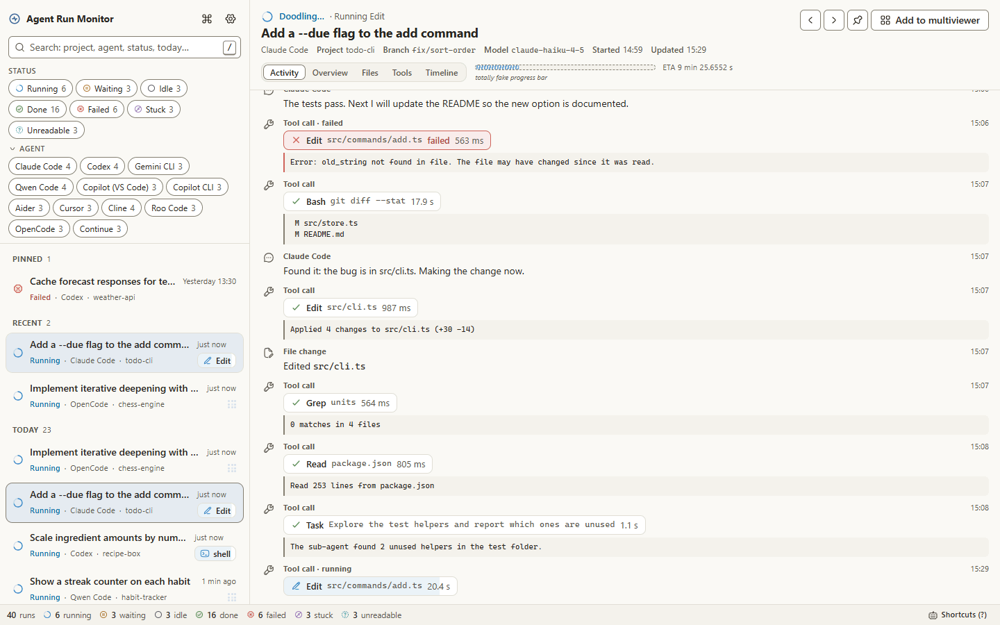

### The dashboard

The app opens on the **dashboard**, its home screen. It has a section for every status (Running, Waiting for you, Idle, Done, Failed, Stuck, Couldn't read this run). Each section shows its 3 most recently updated runs, or a short line when it has none. **See all (n)** opens [All runs](#all-runs-and-folders) filtered to that status. The agent chips at the top filter every section; All runs still lists every agent, so with chips on the link says "every agent". Click a run to open it. To come back, use the dashboard button at the top of the sidebar, press `g` then `d`, or choose "Show the dashboard" in the command palette.

### Token usage

The chart button at the top of the sidebar (or `g` then `u`, or "Show token usage" in the command palette) opens **Usage**: the tokens each agent used **Today**, **This week** (from Monday), **This month** or for **All time**, split into input, output, cache read and cache write, with a total for every agent. Below it, every run active in that range, sortable by any of those columns; click a run to open it. Tokens count on the day their message was recorded, or on the day the run was last updated when the agent doesn't record that. Anything an agent didn't record says **Not reported**, never 0, and runs that reported nothing sort last. Nothing is estimated and no costs are shown, because prices change. Only runs within "How far back to show runs" (Settings) are loaded, so All time covers that period. `Esc` goes back.

### The run list

The left side lists your runs, newest first.

- **Search** with the box at the top (press `/` to jump to it). Words that name an agent, a status or a time become filters. For example `codex failed yesterday` finds Codex runs that failed yesterday, and `weather stuck` finds stuck runs in a project called weather-api. Time words: `today`, `yesterday`, `last hour`, `this week`, `last week`.
- **Filter chips** under the search box filter by status and by agent. "Clear filters" resets them.
- **Sections.** *Pinned* runs stay at the top (pin with `p` or the pin button). *Recent* shows the last 5 runs you opened; opening one never moves it. With **Move updated runs to top** (Settings > Customisation, on by default) Recent is ordered by last update; with it off, Recent keeps its order and a newly opened run appears at the top. Then *Today*, *Yesterday* and *Earlier*.
- **Statuses.** Every status has its own shape and a word, so colour is never the only signal.

| Status | Meaning |
| --- | --- |
| Running | The agent is working right now. |
| Waiting for you | The agent stopped to ask you something, such as approving a command. |
| Idle | The last turn finished recently; the session may continue. |
| Done | Finished and quiet for a while (3 minutes after a completed turn). |
| Failed | The last turn ended in an error, such as an API error or a crash. |
| Stuck | It looked busy, but nothing has happened for too long (for example 20 minutes of silence, or a shell command open for over 12 minutes). |
| Couldn't read this run | The file could not be understood. See [below](#a-run-shows-couldnt-read-this-run). |

### Run views

Each run has six views, plus Reasoning for runs that have it. Switch with the tabs or the keys `1` to `7`:

1. **Activity**: messages, reasoning steps, tool calls and their results, as they happen. Thinking the agent stored without its text (common for recent Claude Code versions) shows as one line, such as "Thinking (3.2 s, text not stored)".
2. **Overview**: a one- or two-sentence summary of what the run is doing or did (built on your computer from the request, files, current tool and counts; optionally written by an AI provider, see [Privacy](#privacy)), status, counts, project, branch, model, start time, duration, token use (input, output and prompt-cache tokens as the agent records them, or "Not reported" when the run has none; never estimated), and the source file with a "Reveal in folder" button.
3. **Files**: the files the run created, edited or deleted.
4. **Tools**: every tool call, with its result and how long it took.
5. **Timeline**: the run over time, with tool calls as bars on lanes. Zoom with the buttons, `+` and `-`, or `Ctrl` + scroll (zooms at the pointer); "Fit to run" (or `0`) shows the whole run again. When zoomed in, drag or scroll sideways to pan. The time axis adapts, from whole seconds to hours or days.
6. **Code changed**: every edit the run applied, oldest first: time, file and lines added and removed, with a total at the top. Click an edit to see its diff (masked like the rest of the run). Agents that don't record an edit's content show the file with "Lines unknown" and no diff, never 0.
7. **Reasoning**: the run's reasoning in full, oldest first. The tab (and key `7`) only appears for runs that stored readable reasoning; every supported agent can, but recent Claude Code versions usually store thinking without its text, so most Claude Code runs don't have it.

The default view is a setting (Settings > Runs & refresh). Reasoning can't be the default, because not every run has it.

Here is the same window in the dark Harbor theme:

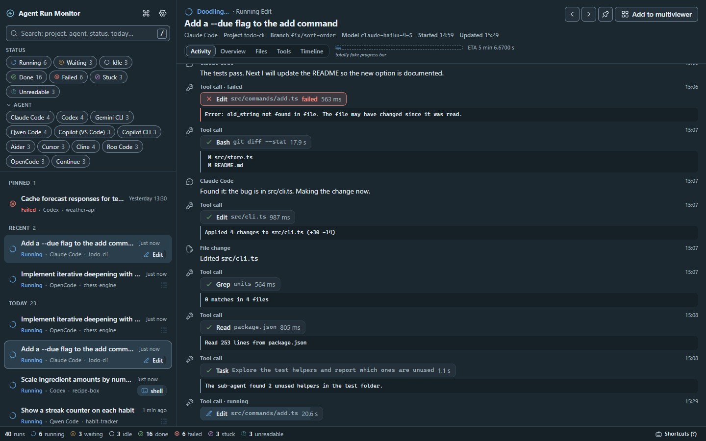

### Getting around

Use `←` and `→` (or `[` and `]`) to go to the previous or next run in the list. `Ctrl+K` (`⌘K` on a Mac) opens the **command palette**. It searches runs the same way as the search box and also runs commands, such as switching the theme, opening settings or turning low GPU mode on or off.

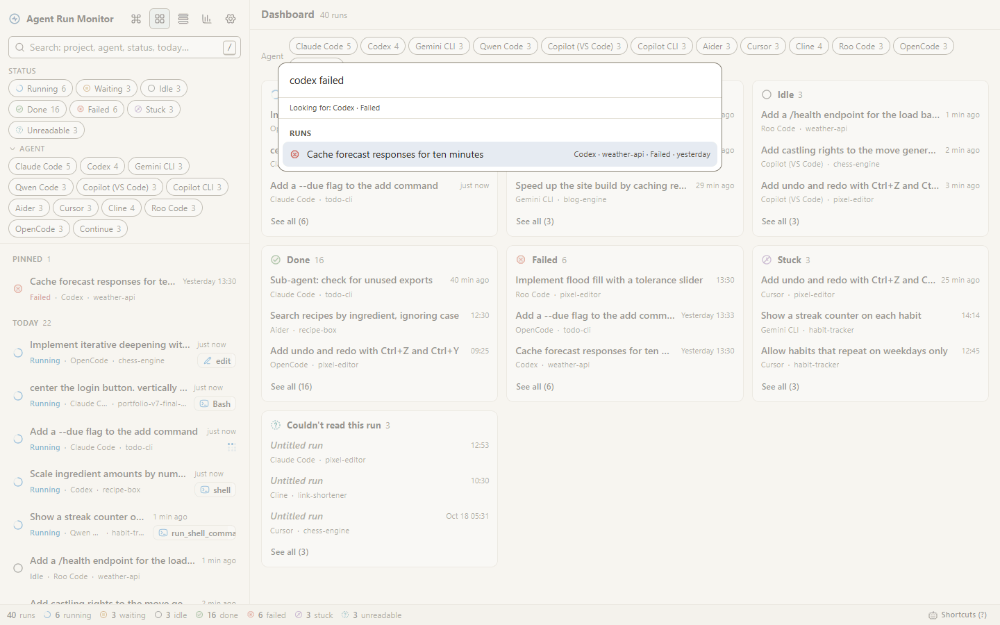

Press `?` at any time for the list of shortcuts (it is also linked from the status bar).

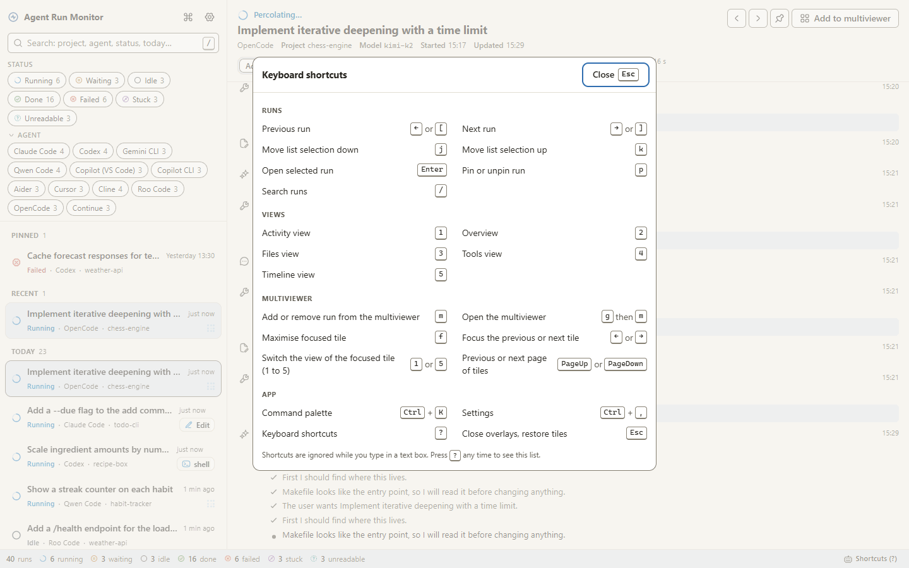

| Keys | What they do |
| --- | --- |
| `←` or `[` | Previous run |
| `→` or `]` | Next run |
| `j` | Move list selection down |
| `k` | Move list selection up |
| `Enter` | Open selected run |
| `p` | Pin or unpin run |
| `/` | Search runs |
| `1` | Activity view |
| `2` | Overview |
| `3` | Files view |
| `4` | Tools view |
| `5` | Timeline view |
| `6` | Code changed view |
| `7` | Reasoning view (runs with readable reasoning) |
| `+` or `-` | Timeline: zoom in or out |
| `0` | Timeline: fit to run |
| `Ctrl` + scroll (`⌘` + scroll on a Mac) | Timeline: zoom at the pointer (drag to pan) |
| `m` | Add or remove run from the multiviewer |
| `g` then `m` | Open the multiviewer |
| `g` then `a` | All runs (organise into folders) |
| `g` then `d` | Dashboard (home) |
| `g` then `u` | Token usage |
| `f` | Maximise focused tile |
| `←` or `→` (in the multiviewer) | Focus the previous or next tile |
| `1` to `6` (in the multiviewer) | Switch the view of the focused tile |
| `PageUp` or `PageDown` | Previous or next page of tiles |
| `Ctrl+K` (`⌘K` on a Mac) | Command palette |
| `Ctrl+,` (`⌘,` on a Mac) | Settings |
| `?` | Keyboard shortcuts |
| `Esc` | Close overlays, restore tiles |

Shortcuts are ignored while you type in a text box.

### All runs and folders

The list button at the top of the sidebar (or `g` then `a`, or "Show all runs" in the command palette) opens **All runs**: every run on one full-width page, grouped by when it started: Today, Yesterday, This week, Earlier this month, then one group per month. Each row shows the folder the run is in. Tick runs (click a row or its box, Shift-click to select a range, or tick a group's box for the whole group), then **Move to folder** to put them in a folder, take them out (Unfiled) or create a new folder for them. Filter by status or folder at the top. **Open** shows a run; `Esc` goes back. Folders are kept in the app's own settings, never in agent files.

### Multiviewer

The multiviewer shows several runs side by side, each updating live.

- **Choose runs** with `m`, the "Add to multiviewer" button, Ctrl-click (⌘-click on a Mac) or Shift-click in the list, or "Add runs" inside the multiviewer.
- **Open it** with `g` then `m`, the "Open multiviewer" button above the list, or the command palette.
- **Up to 12 tiles per page.** The grid follows the number of runs: 2 side by side, up to 4 in a 2 × 2 grid, up to 6 in 3 × 2, up to 9 in 3 × 3, up to 12 in 4 × 3. More runs go on further pages (`PageUp` / `PageDown`). You can lower the limit in Settings > Runs & refresh.
- **Each tile** has its own view tabs, a maximise button (`f`; `Esc` restores) and a remove button. Drag a tile by its handle to reorder (this also works with the keyboard).
- **Layouts.** "Save layout" stores the current set of runs under a name. Open it again from "Layouts".

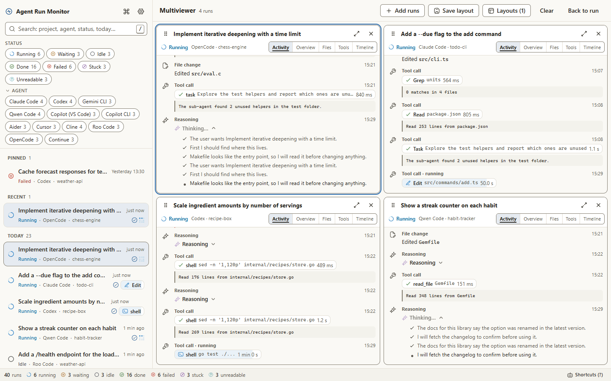

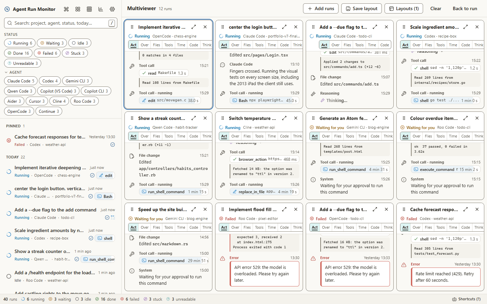

### Settings

Open with `Ctrl+,` (`⌘,` on a Mac) or the gear button. Changes apply straight away.

- **Sources**: switch agents on or off, see where each one looks, add extra folders, add Aider project folders, and **Rescan**.
- **Runs & refresh**: how often live runs are checked (default every 2 seconds), how far back to show runs (default 2 weeks), the default run view and the tiles per multiviewer page.
- **Folders**: create, rename and delete folders for grouping runs by project or client. Folders live in the app's own settings, never in an agent's files; deleting a folder returns its runs to Unfiled and never deletes a run.
- **Notifications**: a desktop notification when a run finishes, and when one fails or gets stuck.
- **Appearance**: six themes (Paper, Sage and Dawn are light; Dusk, Moss and Harbor are dark), your custom theme if you made one, text size, density and time format.
- **Customisation**:
  - **Display**: *Default* is the full app. *Simple* shows only running runs, one large plain line each saying what it's doing, so you can read it from across the room. `Esc` or `Ctrl+,` opens Settings.
  - **Move updated runs to top**: how Recent is ordered (see the run list above).
  - **Custom theme**: **Customise…** (here or next to the themes) starts from the theme in use and lets you pick the background, surface, text, accent and status colours. A live check names every colour pair that fails WCAG AA contrast and any status colours too alike to tell apart. You can save a failing theme, with a visible warning; it is kept as your custom theme, never as one of the presets.
- **Motion & performance**: see below.
- **Fun**: see below.
- **Privacy**: secret masking and the update check.
- **AI summary**: optional AI-written Overview summaries: provider (Anthropic or OpenAI), model, your API key, and the switch, which warns before anything is sent. Off by default.
- **System**: start the app when you sign in.

**Reduce motion and low GPU mode are two different settings.**

- **Reduce motion** is for comfort and accessibility. It stops movement such as spinning marks, sliding panels and rotating words; changes happen instantly. *Auto* (the default) follows your system's "reduce motion" setting.
- **Low GPU usage mode** is for speed and battery life. It keeps animations short and simple, turns off shadows and blur, never loops an animation, and refreshes live views less often (once a second, and every 3 seconds for tiles you are not looking at). What you see stays the same. *Auto* (the default) turns it on when the computer runs on battery.

You can use either, both or neither. When the window is minimised or hidden, all animation stops anyway.

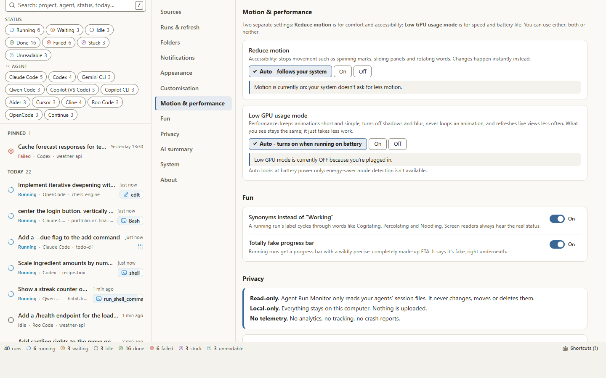

### The fun parts

Two small extras are on by default:

- **Synonyms instead of "Working".** A running run's label cycles through words like Cogitating, Percolating and Noodling. Screen readers always hear the real status, and failed or stuck runs always show plain words.
- **Totally fake progress bar.** Running runs get a progress bar with a wildly precise, completely made-up time left. It says "totally fake progress bar" right underneath, and it never appears on finished or failed runs.

Turn either off in Settings > Fun, or from the command palette (type "synonyms" or "fake").

## Troubleshooting

### My runs don't appear

Work through this list:

1. **Is the agent switched on?** Settings > Sources: the switch next to the agent must be on.
2. **Does its folder exist?** Under "Where it looks", each folder is marked **Found** or **Not there**. If you have just installed the agent or used it for the first time, click **Rescan** (top of Settings > Sources). The agent's run count, next to its name, is then up to date.
3. **Is the run older than the history window?** Settings > Runs & refresh > "How far back to show runs" is 2 weeks by default. Choose a longer time, or All. The window goes by when the agent last wrote to the session, not when it started.
4. **Does the agent save somewhere else?** If you moved its data with an environment variable such as `CLAUDE_CONFIG_DIR`, `CODEX_HOME`, `GEMINI_CLI_HOME`, `COPILOT_HOME`, `CONTINUE_GLOBAL_DIR` or `XDG_DATA_HOME`, the app may not see that variable. Add the folder by hand: Settings > Sources > the agent's card > "Your extra folders" > **Add folder**, and pick the folder in the file picker. Pick the agent's own data folder, the one that plays the part of the folder in [Where each agent stores its sessions](#where-each-agent-stores-its-sessions) (the folder the environment variable points to), not a single project or session folder inside it. For Claude Code that is the folder that contains `projects` (a moved `.claude`), or the `projects` folder itself; a folder inside `projects` finds nothing. When the folder is right, the agent's run count goes up and its runs appear in the list within a few seconds, without restarting the app.
5. **Aider?** Add the folders that hold your projects under Settings > Sources > **Project folders**. Aider writes its history inside each project, so the app can't find it otherwise. Projects more than 4 levels below the folder you add are not searched; add a folder closer to them.
6. **VS Code Copilot?** See [VS Code Copilot chats don't appear](#vs-code-copilot-chats-dont-appear).
7. **Permissions.** The app needs permission to read the folders. On macOS, if your projects are in Documents, Desktop or Downloads, macOS may ask whether the app may access that folder; allow it (or later in System Settings > Privacy & Security > Files and Folders). On Linux, check that the folders belong to your user.
8. **Give it a moment.** With a very large history, the first scan can take a few seconds. Runs appear as they are read.
9. **Still stuck?** [Open a bug report](https://github.com/PastFumbler/agent-run-monitor/issues/new?template=bug_report.yml). Say which agent and version, your operating system, and what Settings > Sources shows for that agent. **Never paste session contents or attach session files**: they can contain your code, file paths and secrets.

### VS Code Copilot chats don't appear

- The app can only show chats that VS Code has saved to disk. VS Code saves a chat once it has at least one message, and it writes in the background, so a brand-new chat can take a moment to show up.
- Chats from a VS Code window with no folder open are saved in a separate place. The app reads those too.
- If you use VS Code Insiders, VSCodium or a portable VS Code, check that its folder is listed under Copilot (VS Code) in Settings > Sources. If not, add it by hand.
- If VS Code closes in the middle of a reply, it saves that request as cancelled, so the run may show as idle or done.

### A run shows "Couldn't read this run"

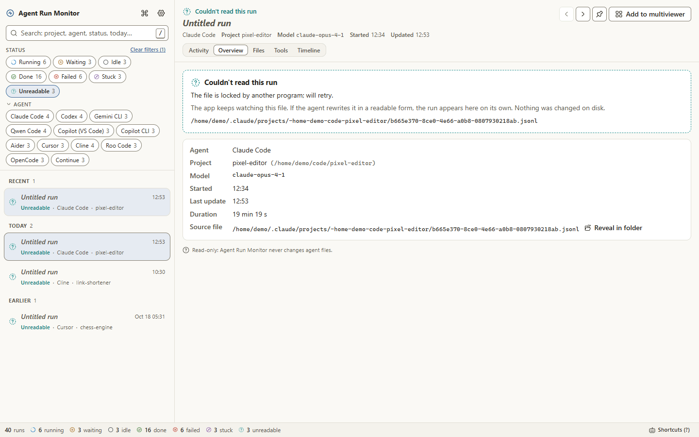

This means the app found the file but could not understand it. The reason is shown on the card. Common causes:

- The agent was updated and changed how it saves sessions.
- The file is locked by another program or is only half written. The app keeps watching the file, so the run fixes itself if the file becomes readable.
- The file is damaged.

Nothing on disk was changed. The rest of the app keeps working.

If many runs from one agent show this after an update, please [report a changed format](https://github.com/PastFumbler/agent-run-monitor/issues/new?template=format_changed.yml). The form asks for the agent, its version and the message on the card. Describe only the *structure* (record types and field names, with every value replaced by a placeholder such as `<string>`). **Do not paste session contents or attach session files.**

### The app uses a lot of GPU or CPU

- Turn on **Low GPU usage mode** (Settings > Motion & performance > On). It cuts most of the drawing work and refreshes live views less often.
- In Settings > Runs & refresh, choose a slower refresh rate (5 or 10 seconds) and a shorter history window.
- Show fewer tiles in the multiviewer. Tiles you can't see already pause.
- Reduce motion also helps, because it stops all movement.

## Uninstall

Removing the app never touches your agents' session files. If you turned on Settings > System > **Start with the operating system**, turn it off first, so no startup entry is left behind for the removed app.

### Windows

**Installer version:**

1. Quit the app.
2. Open **Settings > Apps > Installed apps**, find **Agent Run Monitor** (listed with its version, for example "Agent Run Monitor 0.1.0"), click **⋯** > **Uninstall**, and confirm.
3. The uninstaller asks "Are you sure you want to uninstall Agent Run Monitor?". Click **OK**. It finishes in a few seconds, without asking for administrator rights.

This removes the program folder (`%LOCALAPPDATA%\Programs\agent-run-monitor`), the Start menu and desktop shortcuts, the app's entry in Installed apps, and the copy of the installer that the installer keeps in `%LOCALAPPDATA%\agent-run-monitor-updater`. One folder stays behind on purpose, so a reinstall keeps your settings: `%APPDATA%\Agent Run Monitor`, which holds your settings, saved layouts, window position and the window's cache. To remove everything, delete it too (paste the path into the File Explorer address bar).

**Portable zip:** delete the extracted folder, and `%APPDATA%\Agent Run Monitor` if you want your settings gone too.

### macOS

Quit the app and drag **Agent Run Monitor** from Applications to the Bin. Your settings are in `~/Library/Application Support/Agent Run Monitor`; delete that folder to remove them.

### Linux

Delete the AppImage, or remove the Debian package with `sudo apt remove agent-run-monitor`. Your settings are in `~/.config/Agent Run Monitor` (or under `XDG_CONFIG_HOME` if you set it); delete that folder to remove them.

Settings > About shows the exact path of your settings file.

## FAQ

**Does it send my code or sessions anywhere?**
Not unless you ask it to. The app makes no network requests at all, except two optional features that are off unless you turn them on: the update check, which only asks GitHub for the latest version number, and AI summaries, which send the masked content of the run you open in Overview to the AI provider you chose, with your own key.

**Can it start, stop or approve things in my agents?**
No. It is a viewer. It never writes to an agent's files and has no way to send anything to an agent.

**Will it slow my agents down or lock their files?**
No. It opens files for reading only and reads just the part that is new since last time. Databases (Cursor, OpenCode) are copied first and the copy is read, so the agent's own database is never locked.

**How accurate is the status?**
For Claude Code and Copilot CLI, "waiting for you" comes straight from what the agent records. For the others, and for "stuck", the app judges from the file: what happened last and how long it has been quiet. When the app has had to guess that a run is waiting for you (today this applies to Codex), it says **Probably waiting** instead of **Waiting for you**. It can be wrong for a moment, for example right after a long pause in a busy run. The thresholds are listed under [How it works](#how-it-works).

**Why do I see so many runs from one session?**
Some agents start helper agents (Claude Code's sub-agents and workflow runs, for example). Each one is a run of its own, linked to its parent: the parent's Overview lists them under *Sub-runs*.

**Does it work with WSL, remote machines or containers?**
It reads folders it can reach. On Windows you can add a folder inside WSL by hand, for example `\\wsl$\Ubuntu\home\<you>\.claude`. For VS Code remote sessions, run the app where the agent runs (on Linux it also checks the VS Code server folders for Cline and Roo Code).

**Why is the download so large?**
The app is built with Electron, which includes its own copy of Chromium. That is most of the size.

**Why Electron and not Tauri?**
Tauri was the first choice. It couldn't be built on the development machine (no C++ toolchain, and no administrator rights to install one), and every part of the app had to be tested there. Electron needs only Node.js, which also makes it easy to add an agent: adapters are plain TypeScript. The full reasoning is in [docs/PLAN.md](docs/PLAN.md#2-stack-and-why-electron-rather-than-tauri).

**My agent isn't supported. Can I add it?**
Yes. An adapter is one small folder of TypeScript plus a test fixture. [CONTRIBUTING.md](CONTRIBUTING.md#adding-a-source-adapter) walks through it, or [open an adapter request](https://github.com/PastFumbler/agent-run-monitor/issues/new?template=adapter_request.yml).

## Code overview

A quick tour for anyone who wants to read, fix or extend the code. The design document with the full reasoning is [docs/PLAN.md](docs/PLAN.md).

### Stack

| Part | Built with |
| --- | --- |
| Desktop shell | [Electron](https://www.electronjs.org/) 45, packaged with electron-builder (NSIS and zip on Windows, dmg on macOS, AppImage and deb on Linux) |
| Background process | TypeScript on Node 24: [chokidar](https://github.com/paulmillr/chokidar) for file watching, Node's built-in `node:sqlite` for databases (no native modules) |
| Window | React 19, [zustand](https://github.com/pmndrs/zustand) for state, [cmdk](https://cmdk.paco.me/) for the command palette, [dnd-kit](https://dndkit.com/) for tile dragging, [TanStack Virtual](https://tanstack.com/virtual) for long lists, [motion](https://motion.dev/) and eight [React Bits](https://github.com/DavidHDev/react-bits) components for animation |
| Build | electron-vite and Vite |
| Tests | Vitest (unit and component), Playwright (in the browser and in the real Electron app) |

### Repository map

```
src/
  shared/        Types used by both sides: the run and event schema, settings, the IPC contract
  core/          Plain Node, no Electron. Testable on its own.
    adapters/    One folder per agent family (claude-code, codex, gemini, copilot, aider,
                 cursor, vscode-agents, opencode), each with its tests
    store.ts     RunStore: discovery, watching, incremental parsing, status clock, batching
    status.ts    Turns "what the file says + how long it's been quiet" into a status
    build.ts     Turns an adapter's result into RunSummary / RunDetail; crash-proof parsing
    masking.ts   Secret masking
    jsonl.ts     Incremental, read-only JSONL reader (resumes from a byte offset)
    sqlite.ts    Copy-then-read SQLite snapshots; the only file in core allowed to write
  main/          Electron main process: window, security, IPC handlers, settings file,
                 notifications, power state, start-with-OS, update check
  preload/       Exposes a typed `window.armBackend` to the window, nothing else
  renderer/      The React app
    src/backend/   ElectronBackend (real data) and FixtureBackend (demo data, tests)
    src/features/  dashboard, runlist, allruns, usage, runview, multiview, palette, shortcuts, settings, wizard, statusbar
    src/theme/     Six themes as CSS variables, and the contrast test
    src/motion/    The motion policy: reduce motion, low GPU mode, hidden window
    src/vendor/react-bits/  Vendored React Bits components (own licence)
test/fixtures/   Sample session files per agent, including corrupt ones
e2e/             Playwright tests of the UI with demo data, in a browser
e2e-electron/    Playwright tests of the real Electron app
scripts/         Secret scan, live-run simulator, screenshots and GIF, GPU measurement,
                 Smart App Control audit
docs/            PLAN.md (design), BLOCK-TEST.md (Smart App Control test), images
```

### The life of an update

1. An agent appends a line to its session file.
2. The watcher in `core/store.ts` notices (a slow poll catches anything the file events miss) and marks that run as changed.
3. The agent's adapter `parse()`s the run again, starting from the byte offset where it stopped last time, so only the new lines are read.
4. `core/status.ts` judges the status, and `core/build.ts` builds the `RunSummary` (for the list) and, for runs on screen, the `RunDetail` (events, files, tool calls), with secrets masked.
5. The store collects changes and flushes them in one batch per interval over IPC.
6. The preload bridge hands them to the window's zustand store, and only the components showing those runs re-render.

### The common format

The window only ever sees these types (from `src/shared/schema.ts`, shortened):

```ts
interface RunSummary {
  id: string;                 // stable across restarts
  agent: AgentId;             // 'claude-code' | 'codex' | 'gemini-cli' | ...
  title: string;              // usually the first prompt
  projectName: string;
  model?: string;
  startedAt: number;
  updatedAt: number;
  status: 'running' | 'waiting' | 'idle' | 'done' | 'failed' | 'stuck' | 'unreadable';
  statusInferred?: boolean;   // true when 'waiting' was worked out rather than recorded
  statusDetail?: string;      // plain words, e.g. "Waiting for tool approval"
  counts: { events: number; toolCalls: number; errors: number; filesChanged: number; /* ... */ };
  usage?: { input?: number; output?: number; cacheRead?: number; cacheWrite?: number; byDay?: /* ... */ };
                              // absent when the agent records no tokens; never estimated
  hasReasoning?: boolean;     // the run has reasoning with readable text
  sourcePath: string;
  parentId?: string;          // sub-agent runs point at their parent
}

interface RunEvent {
  kind: 'user' | 'assistant' | 'reasoning' | 'tool_call' | 'tool_result' | 'file_change' | 'error' | 'system';
  text: string;               // already masked
  ts?: number;
  toolName?: string;
  toolCallId?: string;        // pairs a call with its result
  filePath?: string;
  isError?: boolean;
  usage?: { /* ... */ };      // tokens the agent reported with this message
  placeholder?: boolean;      // the agent stored no readable text (e.g. hidden reasoning)
}

// RunDetail also lists each applied edit: time, file, lines added and removed (undefined when the
// agent does not record the edit's content), and the diff when it does, masked like event text.
```

### Adapters

Each agent is supported by an adapter that implements this contract (from `src/core/adapter.ts`, shortened):

```ts
interface SourceAdapter {
  id: AgentId;
  displayName: string;
  confidence: 'verified' | 'source' | 'best-effort';
  defaultRoots(env: Env): string[];                           // where to look, per OS
  discover(roots: string[], ctx: DiscoverContext): Promise<SessionRef[]>;            // cheap: list and stat only
  parse(ref: SessionRef, prev: ParseState | undefined, ctx: ParseContext): Promise<ParseState>; // incremental
  isRelevantChange?(path: string): boolean;                   // ignore cache folders
  isLiveSignal?(path: string): boolean;                       // side files that change a live run
}
```

`parse()` fills a `ParsedRun` (title, project, events, whether the last turn is in progress, completed, waiting, failed or aborted, any open tool call) and the shared code does the rest. Whatever an adapter throws becomes a "Couldn't read this run" card. Unknown record types are skipped and counted, never fatal. That way a new agent version degrades gently instead of breaking the app.

To add an agent, follow [CONTRIBUTING.md: Adding a source adapter](CONTRIBUTING.md#adding-a-source-adapter).

### Security boundaries

- **The window can't touch your disk.** It runs sandboxed with context isolation and no Node.js. Its only door is the typed `Backend` interface in `src/shared/ipc.ts`, and every call is validated in `src/main/ipc.ts`.
- **No network.** `src/main/security.ts` sets a strict Content Security Policy, blocks navigation, pop-ups and every permission request, and cancels any web request that is not for the app's own files. The opt-in update check and opt-in AI summaries (`src/main/ai.ts`) are allowed one URL at a time, only while they run, each from its own session.
- **Read-only parsing.** `src/core/readonly.test.ts` fails the build if any code in `src/core` other than the SQLite snapshot helper uses a file-writing API. The app writes only its own files (settings, window state and, if you use AI summaries, the encrypted key and the summary cache) into its own settings folder (`src/main/files.ts`, `src/main/ai.ts`).
- **No child processes, no native modules.** This keeps the app's footprint small and predictable, which also matters for Windows Smart App Control (see [docs/BLOCK-TEST.md](docs/BLOCK-TEST.md)).

### Tests

| What | Where | Run with |
| --- | --- | --- |
| Adapters, against sample files for every agent (normal, corrupt, unknown records, incremental reads, status) | `src/core/adapters/*/*.test.ts`, `test/fixtures/` | `npm test` |
| Run store, status rules, masking with planted fake keys, the read-only guard | `src/core/*.test.ts` | `npm test` |
| Every theme meets WCAG AA contrast and keeps status colours distinguishable | `src/renderer/src/theme/contrast.test.ts` | `npm test` |
| UI components, motion policy, multiviewer grid, settings logic | `src/renderer/**/*.test.ts(x)` | `npm test` |
| The whole UI in a browser with demo data: navigation, palette, every grid size, settings, wizard, reduced motion | `e2e/` | `npm run test:e2e` |
| The real Electron app: masking end to end, reduced motion, navigation and multiviewer, hidden-window throttling | `e2e-electron/` | `npm run test:electron` |

CI runs the type check, the unit tests, the browser tests and a packaging check on Windows, macOS and Linux for every push and pull request, the Electron app tests on Windows and Linux, and the secret scan over the whole history. A tagged release runs the type check and unit tests again before it builds anything.

## Development

You need [Node.js](https://nodejs.org/) 24 and Git.

```sh
git clone https://github.com/PastFumbler/agent-run-monitor.git
cd agent-run-monitor
npm ci
npx install-electron   # downloads Electron itself; npm ci does not run install scripts
npm run dev            # the app with hot reload, reading your real session files (read-only)
```

| Command | What it does |
| --- | --- |
| `npm run dev` | Start the app with hot reload |
| `npm run dev:web` | Only the window, in your browser at http://localhost:5317, with made-up demo runs and nothing from your disk. The quickest way to work on the UI |
| `npm test` | Unit and component tests (Vitest) |
| `npm run test:e2e` | UI tests in Chrome against the demo |
| `npm run test:electron` | Build, then test the real Electron app |
| `npm run typecheck` | TypeScript check |
| `npm run build` | Build into `out/` |
| `npm run dist` | Build installers for your system into `release/` (unsigned unless signing is set up) |
| `npm run scan-secrets` | Scan the files and the whole git history for secrets and personal paths |
| `node scripts/simulate-live-runs.mjs` | Write synthetic, live Claude Code sessions into a folder, for testing without a real agent |
| `node scripts/make-screenshots.mjs`, `node scripts/make-gif.mjs` | Regenerate the pictures on this page from the demo |

**Demo URL options** (with `npm run dev:web`): `?scenario=demo|empty|firstrun|many` (`many` has 300 runs), `?live=0` to freeze the demo, `?battery=1` to act as if on battery.

**Environment switches** for testing the real app without touching your own data:

| Variable | Effect |
| --- | --- |
| `ARM_HOME` | Use this folder as the home folder when looking for agents |
| `ARM_USER_DATA` | Keep settings in this folder instead of the normal one |
| `ARM_OPEN_LAYOUT` | Open this saved multiviewer layout on start |
| `ARM_E2E=1` | Test mode: no desktop notifications, no start-with-OS |

If Electron starts as plain Node and no window opens, your shell has `ELECTRON_RUN_AS_NODE` set (VS Code terminals often do). Unset it first.

### Releasing

1. Update `version` in `package.json` and `CHANGELOG.md`, commit, and push a tag such as `v0.2.0` (it must match the version).
2. The release workflow builds the installers on Windows, macOS and Linux and uploads them to a **draft** GitHub Release.
3. On Windows it then runs the Smart App Control audit (`scripts/check-blocks.ps1` and `scripts/runtime-modules.mjs`) and attaches its report to the release. If signing is set up, any file of ours without a valid signature fails the release.
4. Check the draft, then publish it.

Signing is optional and driven by repository secrets and variables. On Windows: either a PFX certificate (secrets `WIN_CSC_LINK` and `WIN_CSC_KEY_PASSWORD`) or Azure Artifact Signing (secrets `AZURE_TENANT_ID`, `AZURE_CLIENT_ID`, `AZURE_CLIENT_SECRET` and variables `AZURE_SIGN_ENDPOINT`, `AZURE_SIGN_ACCOUNT`, `AZURE_SIGN_PROFILE`, `AZURE_SIGN_PUBLISHER`), plus the variable `WIN_EXPECTED_PUBLISHER` that the audit checks signatures against. On macOS: secrets `CSC_LINK`, `CSC_KEY_PASSWORD`, `APPLE_ID`, `APPLE_APP_SPECIFIC_PASSWORD` and `APPLE_TEAM_ID`. Without them the builds are unsigned and the audit only reports.

If you publish your own fork, run `npm run set-repo -- <you>/agent-run-monitor` first so every link points at your repository.

## Project status

Version 0.1.0, not yet released.

- **Claude Code** support is verified on a real installation. The other eleven agents are built from their published source code and tested with sample files written to match it; **Cursor** is experimental because it is closed source. Real-world reports help move them to "verified": see the [adapter request and format change forms](https://github.com/PastFumbler/agent-run-monitor/issues/new/choose).
- **Builds are not code-signed yet.** Windows and macOS will warn the first time you open the app (see [Install](#install)).
- **Next up:** Goose and Crush adapters, signed builds, and real-session fixtures for more agents.

## Contributing

Bug reports, fixes and new agents are welcome. [CONTRIBUTING.md](CONTRIBUTING.md) explains the setup, the tests, the privacy rules for contributors and how to add an agent. Report security problems privately, as described in [SECURITY.md](SECURITY.md). Changes are listed in [CHANGELOG.md](CHANGELOG.md). What was tested before the release, and what could not be, is in [docs/VERIFICATION.md](docs/VERIFICATION.md).

## Licence

Agent Run Monitor is open source under the [MIT licence](LICENSE).

It includes a few components adapted from [React Bits](https://github.com/DavidHDev/react-bits) (only components from its free, public repository). Those files, in `src/renderer/src/vendor/react-bits/`, keep their own licence: MIT with the Commons Clause, which means they may not be sold or redistributed on their own. The full text, and the licences of every other package the app ships with, are in [THIRD_PARTY_NOTICES.md](THIRD_PARTY_NOTICES.md).
